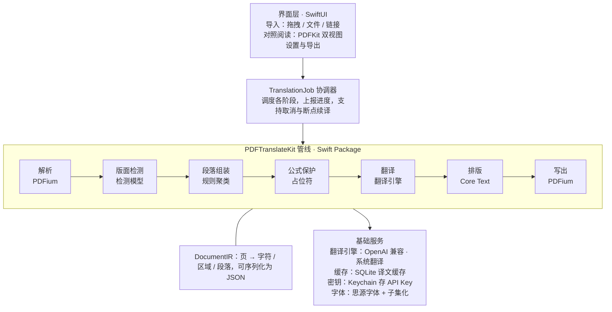
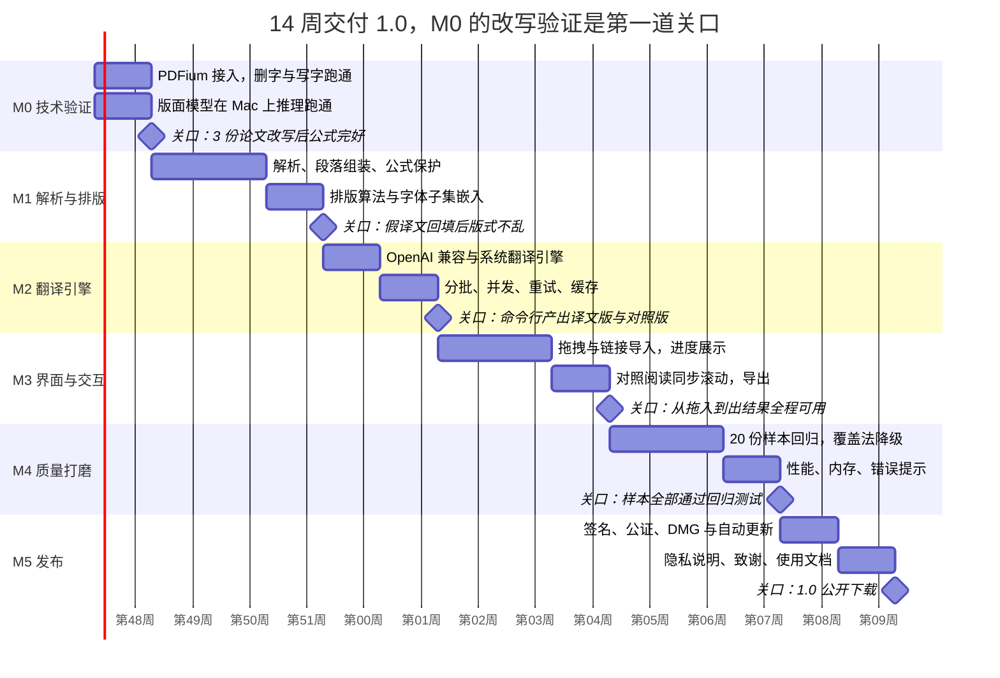

# macOS 原生 PDF 对照翻译应用 · 开发计划手册

更新日期：2026-11-15

产品目标：用户拖入 PDF 或粘贴 PDF 链接，应用调用 AI 翻译，输出一份保留原版式的译文 PDF 和一份原文/译文对照 PDF。原文件不被修改。

---

## 1. 产品定位与范围

产品是一款单窗口 macOS 应用：用户拖入 PDF 或粘贴 PDF 链接，应用自动翻译并输出一份保留原版式的译文 PDF 和一份原文/译文对照 PDF。原文件永不被修改，所有结果写入新文件。

| 项目 | MVP（v1.0）包含 | 后续版本 |
| --- | --- | --- |
| 输入 | 本地 PDF 拖拽、文件选择、PDF 直链（含 arXiv 链接） | 批量队列、文件夹监听 |
| 文档类型 | 文字型 PDF（论文、报告、手册） | 扫描件 OCR |
| 翻译方向 | 英文 → 简体中文为主，语言可选 | 任意语言对 |
| 翻译引擎 | OpenAI 兼容接口（含 DeepSeek、硅基流动、Ollama 本地）、Apple 系统翻译 | DeepL、Gemini、Claude 原生接口 |
| 输出 | 译文 PDF（mono）、对照 PDF（dual，左原文右译文） | 上下交替对照、仅导出选定页 |
| 阅读 | 应用内左右同步滚动对照阅读 | 点击译文段落高亮对应原文 |
| 保留元素 | 公式、图片、表格线、页眉页码、目录、链接 | 表格单元格内翻译、跨页段落合并 |

三条设计原则贯穿全手册：

- **不动原文**：原 PDF 只读打开，译文写入 `原文件名-zh.pdf` 与 `原文件名-dual.pdf`。
- **零配置起步**：首次启动只需选一个翻译服务并填 Key；选 Apple 系统翻译时连 Key 都不需要。
- **许可证干净**：全部依赖限定在 MIT / BSD / Apache-2.0，保证可闭源、可上架 Mac App Store。

---

## 2. 参考开源项目

可直接集成的只有 PDFium、PP-DocLayout、ONNX Runtime 和 HarfBuzz；PDFMathTranslate 系列与 DocLayout-YOLO 都是 AGPL-3.0，只能读文档学思路。

| 项目 | 是什么 | 许可证 | 借鉴或使用方式 | 能否打包进应用 |
| --- | --- | --- | --- | --- |
| [PDFMathTranslate](https://github.com/PDFMathTranslate/PDFMathTranslate)（pdf2zh 1.x） | 保留版式的科学论文 PDF 翻译工具，输出 mono 与 dual 两个文件 | AGPL-3.0 | 整体管线、公式保护思路、双文件输出、翻译服务清单 | 否 |
| [PDFMathTranslate-next](https://github.com/PDFMathTranslate/PDFMathTranslate-next)（pdf2zh 2.x） | 基于 BabelDOC 的 2.0 版本，官方的 BabelDOC 调用参考实现 | AGPL-3.0 | 配置项设计、界面选项、服务接入方式 | 否 |
| [BabelDOC](https://github.com/funstory-ai/BabelDOC) | 新一代翻译后端，把 PDF 解析成中间表示（IL）再重新渲染 | AGPL-3.0 | 中间表示、段落识别、排版缩放算法、自动术语表 | 否 |
| [DocLayout-YOLO](https://github.com/opendatalab/DocLayout-YOLO) | pdf2zh 使用的版面检测模型 | AGPL-3.0 | 只了解其类别划分，不使用权重 | 否 |
| [PP-DocLayout](https://arxiv.org/abs/2503.17213)（PaddleOCR） | 识别 23 类版面区域的检测模型，有 L / M / S 三档和 ONNX 导出 | Apache-2.0 | 作为本项目的版面检测模型 | 能 |
| [PDFium](https://pdfium.googlesource.com/pdfium/+/main/public/fpdf_edit.h) | Chrome 的 PDF 引擎，C API 支持逐字符提取、删除页面对象、嵌入字体并写入文本 | Apache-2.0 或 BSD-3-Clause | 解析与改写 PDF 的底层库，用 [pdfium-binaries](https://github.com/bblanchon/pdfium-binaries) 的 macOS 通用预编译包 | 能 |

ONNX Runtime（MIT）用于模型推理，HarfBuzz（MIT 风格）用于字体子集化，思源黑体与思源宋体（SIL OFL）用于译文字体。这三项许可证为常识性信息，接入前请在各自仓库再确认一次。

原生 Mac 应用的交互可参考两个 Swift 项目：

- [PDFRead](https://everettjf.github.io/pdfread/)：原文与译文左右并排、句级对齐，译文以 JSON 缓存在本地。
- [Leaf Reader](https://github.com/dowellhz/LeafReader)：Swift + PDFKit + WebKit 的阅读器，用 Sparkle 做应用内更新。

---

## 3. 核心原理：参考项目如何保留版式

保留版式的关键是只替换正文文字，其余元素（公式、图片、表格线、背景）原样留在原位。PDFMathTranslate 与 BabelDOC 的管线可归纳为七步，本项目用 Swift 逐步重写：

1. **解析**：逐字符读出文字、字体、字号、坐标，建立与渲染无关的中间表示。pdf2zh 用 pdfminer.six，BabelDOC 自建了 PDF 解释器。
2. **版面检测**：把页面渲染成图片，用检测模型标出标题、正文、图、表、公式、页眉页脚等区域。
3. **段落组装**：把字符按版面区域聚成行，再聚成段，并确定阅读顺序。
4. **公式与样式识别**：判断哪些字符属于公式，用占位符替代后不送翻译；记录粗体、斜体等样式段。
5. **翻译**：段落文本连同占位符发给大模型，多线程并发；BabelDOC 还会先用模型抽取术语表。这是耗时最长的阶段。
6. **排版**：译文在原段落框内重新断行。放不下时，BabelDOC 先把行距从 1.5 按 0.1 逐步降到 1.4，仍放不下再缩小字号。公式与原样保留的字符只移动位置，不重新排版。
7. **生成**：删除原正文文字，写入译文并嵌入字体，输出译文版；再把原页与译文页拼在一起，输出对照版。

BabelDOC 自述的已知局限也是本项目要预留的难点：作者段与参考文献段可能被合并、表格和首字下沉支持不完整、跨页段落尚未支持、超大页面会被跳过。

---

## 4. 技术选型

界面、并发、排版、显示全部用 Apple 原生框架；只有“改写 PDF 内容流”和“运行检测模型”两处引入 C/C++ 库，因为 PDFKit 没有删除页面内文字的公开接口。

| 层次 | 选型 | 说明 |
| --- | --- | --- |
| 语言 | Swift 6，开启严格并发检查 | 管线各阶段用 `actor` 与 `async/await` 组织 |
| 界面 | SwiftUI，`PDFView` 用 `NSViewRepresentable` 桥接 | 设置用 `Settings` 场景，状态用 `@Observable` |
| PDF 显示 | PDFKit | 对照阅读、缩略图、搜索、打印 |
| PDF 解析与改写 | PDFium（SwiftPM `binaryTarget` 引入 xcframework） | 逐字符坐标、删除文本对象、嵌入字体、写文本、N-up 拼页 |
| 页面光栅化 | Core Graphics（`CGPDFPage` 绘制到位图） | 给版面模型提供输入图像 |
| 版面检测 | PP-DocLayout ONNX + ONNX Runtime（Core ML 执行后端） | M0 阶段评估能否转成 `.mlpackage` 改用纯 Core ML |
| 排版度量 | Core Text（`CTTypesetter`、`CTLine`） | 字宽度量、断行、中文标点禁则 |
| 字体 | 思源黑体 / 思源宋体，HarfBuzz 子集化后嵌入 | 只嵌入用到的字形，控制输出文件体积 |
| 网络 | `URLSession` + `AsyncSequence` | 链接下载、模型接口、流式响应 |
| 系统翻译 | Apple Translation 框架 `TranslationSession` | 离线、免费、无需 Key，支持批量翻译 |
| 扫描件（后续） | Vision `RecognizeDocumentsRequest` | macOS 26 起提供段落、表格、列表结构，全部本地运行 |
| 存储 | SwiftData（任务历史）+ SQLite（翻译缓存） | 缓存放 `~/Library/Caches`，可一键清空 |
| 密钥 | Keychain Services | API Key 不写入 `UserDefaults` 或日志 |
| 更新 | Sparkle（官网分发版） | Mac App Store 版由商店更新 |

最低系统定为 macOS 15：`TranslationSession` 从 macOS 15 起可用。macOS 26 及以上再启用 Vision 文档结构识别，用 `if #available` 分支。

### 译文回填的两条路线

| | A 覆盖法 | B 改写法（主路线） |
| --- | --- | --- |
| 做法 | 把原页画进新 PDF，用背景色矩形盖住原文，再用 Core Text 画译文 | 用 PDFium 删除原文本对象，插入新的译文文本对象 |
| 依赖 | 纯 Core Graphics，无第三方库 | PDFium |
| 输出质量 | 原文仍藏在底层，可被搜索和复制；彩色或渐变背景会露出色块 | 只剩译文，背景不受影响 |
| 用途 | 某页改写失败时的逐页降级方案 | 默认方案 |

---

## 5. 系统架构

应用分四层：界面层只与协调器对话，协调器按顺序驱动七个管线模块，模块之间只通过 `DocumentIR` 交换数据。



一次翻译的数据流从左到右走完管线：解析与写出依赖 PDFium，翻译阶段调用基础服务中的引擎与缓存，其余阶段全部在本机完成。

---

## 6. 核心模块设计

七个模块都只读写同一个中间表示 `DocumentIR`，模块之间不直接调用，因此每个模块都能单独测试和替换。

### 6.1 中间表示 DocumentIR

```swift
struct DocumentIR: Sendable, Codable {
    var pages: [PageIR]
}

struct PageIR: Sendable, Codable {
    let index: Int
    let mediaBox: CGRect              // PDF 坐标系，原点在左下角
    var chars: [CharIR]               // 解析阶段填充
    var regions: [LayoutRegion]       // 版面检测阶段填充
    var paragraphs: [ParagraphIR]     // 段落组装阶段填充
}

struct CharIR: Sendable, Codable {
    let unicode: String
    let box: CGRect
    let fontName: String
    let fontSize: CGFloat
    let color: RGBAColor
    let objectID: Int                 // 所属 PDF 文本对象，写出阶段据此删除
    var isFormula = false
}

struct LayoutRegion: Sendable, Codable {
    enum Kind: String, Codable { case title, text, list, caption, footnote,
                                  figure, table, formula, header, footer, other }
    let kind: Kind
    let box: CGRect
    let confidence: Float
}

struct ParagraphIR: Sendable, Codable, Identifiable {
    let id: UUID
    let box: CGRect
    let kind: LayoutRegion.Kind
    var segments: [Segment]           // 文本段与公式段交替
    var sourceText: String            // 含 {v1} 占位符，送翻译
    var translatedText: String?
    var layout: TypesetResult?        // 排版阶段填充
}
```

`DocumentIR` 可序列化为 JSON，用于断点续译、调试和快照测试。

### 6.2 解析 PDFParser

- 用 PDFium 的文本页接口逐字符读取 Unicode、字符框、字号、字体名，并记录字符所属的文本对象。
- 加密文档弹出密码框；无文字层的页面标记为扫描页，MVP 直接跳过并在结果里提示。
- 解析按页进行，每页产出后立即释放 PDFium 页句柄，控制大文件内存。

### 6.3 版面检测 LayoutDetector

- 每页用 Core Graphics 渲染成模型要求的输入尺寸，送入 PP-DocLayout，得到区域框、类别、置信度。
- 把模型的 23 类映射到 `LayoutRegion.Kind`。标题、正文、列表、图表标题、脚注参与翻译；图、表、公式、页眉页脚原样保留。
- 检测框做非极大值抑制，并扩展到恰好包住框内全部字符。
- 模型随应用打包，首次启动无需下载；推理放在独立 `actor` 中串行执行。

### 6.4 段落组装 ParagraphBuilder

- 区域内字符按基线聚成行，行按垂直间距和首行缩进聚成段。
- 行尾连字符断词（`trans-` + `lation`）合并回完整单词。
- 阅读顺序按栏排序：先按区域左边界分栏，栏内自上而下。
- 没有被任何区域覆盖的零散文字保持原样，不翻译。

### 6.5 公式与样式保护 FormulaGuard

满足任一条件的字符标记为公式：

- 落在版面检测的公式区域内；
- 字体名命中数学字体规则（如 `CMMI`、`CMSY`、`CMEX`、`MSBM`、`Symbol`，或含 `Math`）；
- 字号明显小于所在行且基线偏移，即上下标；
- Unicode 属于数学运算符或希腊字母区段。

相邻的公式字符合并成一个公式段，在 `sourceText` 中写成 `{v1}`、`{v2}`。字体规则做成可配置的正则表，允许用户在高级设置中追加。

### 6.6 排版 Typesetter

目标是把译文和公式段放回原段落框。步骤：

1. 把译文按占位符拆成文本单元和公式单元；公式单元尺寸固定，取自原字符框。
2. 用 Core Text 度量文本单元宽度，从段落框左上角逐行摆放，遵守中文标点禁则，中英文之间加四分之一字宽间距。
3. 放不下时先把行距从 1.5 逐步降到 1.4；仍放不下则按 5% 步长缩小字号。
4. 字号缩到下限（建议为原字号的 60%，可配置）仍放不下时，若段落下方有空白则向下扩展段落框。
5. 同一页正文段落统一取最小缩放值的近似，避免相邻段落字号忽大忽小。

标题沿用原对齐方式（居中或左对齐），正文两端对齐。

### 6.7 写出 PDFWriter

译文版（mono）：

1. 把原文档整体复制到新文档，原文件不动。
2. 逐页删除已翻译段落对应的文本对象（`FPDFPage_RemoveObject`）。
3. 用子集化后的中文字体创建文本对象（`FPDFText_LoadFont`、`FPDFText_SetText`），按排版结果设置变换矩阵后插入页面。
4. 每页调用 `FPDFPage_GenerateContent` 生成内容流，最后保存为新文件。

对照版（dual）：把原页与译文页按“原 1、译 1、原 2、译 2”交替导入一个文档，再用 PDFium 的 N-up 导入把每两页拼成一张宽页，左原文右译文。目录书签和链接注释从原文档复制。

需要在 M0 验证的难点：一个文本对象里同时有正文和公式字符时，删除对象会连公式一起删掉，必须把公式字符按原字体、原坐标重新写回。若某页写回失败，该页降级为覆盖法。

### 6.8 导入 Importer

- 拖拽和文件选择只接受 `UTType.pdf`；链接输入接受 `http/https`。
- arXiv 的 `abs` 链接自动改写为 `pdf` 地址；其他链接校验响应头为 `application/pdf`，否则提示“该链接不是 PDF 文件”。
- 下载到应用容器的临时目录，显示下载进度，可取消。

---

## 7. AI 翻译服务层

所有引擎实现同一个协议，管线只依赖协议；新增一个服务只需新增一个类型。

```swift
protocol TranslationEngine: Sendable {
    var id: String { get }
    var maxBatchCharacters: Int { get }
    func translate(_ batch: [TranslationUnit],
                   from source: Locale.Language,
                   to target: Locale.Language,
                   glossary: [GlossaryEntry]) async throws -> [TranslationResult]
}

struct TranslationUnit: Sendable { let id: UUID; let text: String }      // 含 {v1} 占位符
struct TranslationResult: Sendable { let id: UUID; let text: String }
```

| 引擎 | 接入方式 | 需要 Key | 适用场景 |
| --- | --- | --- | --- |
| OpenAI 兼容 | `POST /v1/chat/completions`，用户填 Base URL、模型名、Key | 是 | OpenAI、DeepSeek、硅基流动、通义、智谱等兼容接口 |
| Ollama 本地 | 同上，Base URL 指向 `http://localhost:11434/v1` | 否 | 完全离线、文档不出本机 |
| Apple 系统翻译 | `TranslationSession` 的批量接口 | 否 | 零配置试用、离线 |

Apple 系统翻译有两点注意：会话通过 SwiftUI 的 `translationTask` 修饰符获得，首次使用某语言对时系统会弹窗请求下载语言包；它不是大模型，占位符可能被改写，所以该引擎改为按占位符切分后分段翻译。

### 提示词

系统提示词固定四条规则，版本号写入缓存键：

- 只输出译文，不加解释；
- `{v1}` 这类占位符原样保留，数量和编号不变，可按目标语言语序移动；
- 按术语表翻译专有名词，人名、模型名、代码不译；
- 输入是 JSON 数组 `[{"id":…, "text":…}]`，输出同结构。

### 调度与可靠性

- **分批**：按阅读顺序把相邻段落合成一批，单批不超过引擎的 `maxBatchCharacters`，让模型看到上下文。
- **并发**：用 `withThrowingTaskGroup` 限制并发数，默认 4，可在设置中调整。
- **重试**：遇到 429 或 5xx 按指数退避重试 3 次；超时默认 60 秒。
- **校验**：返回的占位符集合必须与原文一致；不一致则该段单独重译一次，仍失败则保留原文并在结果中标记。
- **缓存**：键为 `SHA256(引擎 + 模型 + 提示词版本 + 语言对 + 原文)`，命中则不请求网络；中断后重新翻译只补未完成的段落。
- **术语表**：第二阶段加入自动抽取，先让模型从摘要和标题抽取术语，再随每批请求下发；同时支持导入 CSV。
- **隐私**：选择云端引擎时，首次翻译前明示“文档文字将发送到你配置的服务商”；应用自身不设中转服务器，不收集文档内容。

---

## 8. 界面与交互

整个应用只有一个主窗口和三种状态，用户从打开应用到拿到译文只需一次拖拽。

| 状态 | 界面内容 | 可用操作 |
| --- | --- | --- |
| 空状态 | 居中的拖放区，文案“把 PDF 拖到这里，或粘贴链接”；下方一个链接输入框和最近文档列表 | 拖入文件、⌘O 选文件、⌘V 粘贴链接 |
| 翻译中 | 左侧显示原文，右侧逐页出现译文；顶部进度条显示当前阶段与“第 n / N 页” | 取消、继续阅读已完成的页 |
| 已完成 | 左右对照阅读，滚动与缩放同步；工具栏可导出 | 导出译文版或对照版（⌘E）、拖出文件、在访达中显示、重新翻译某一页 |

工具栏只放四项：目标语言、翻译引擎、视图切换（对照 / 仅译文 / 仅原文）、导出。其余选项进入设置窗口（⌘,）：

- **翻译服务**：引擎列表、Base URL、模型名、API Key、“测试连接”按钮、并发数。
- **输出**：默认保存位置（原文件旁或指定文件夹）、译文字体（黑体 / 宋体）、对照版面（左右 / 上下交替）。
- **高级**：术语表、公式字体规则、最小字号比例、清空缓存。

原生体验清单：

- [ ] 窗口、Dock 图标、访达“打开方式”都能接收 PDF；Dock 图标显示翻译进度。
- [ ] 拖放用 `dropDestination(for: URL.self)`，文件选择用 `fileImporter`。
- [ ] 两个 `PDFView` 通过监听滚动与 `PDFViewPageChanged` 通知保持同步。
- [ ] 翻译完成发送系统通知；应用在后台时任务继续运行。
- [ ] 支持深色模式、全屏、窗口状态恢复、旁白（VoiceOver）标签、完整的菜单栏命令与快捷键。
- [ ] 错误信息说明原因和下一步，例如“API Key 无效，请在设置中检查”，不显示原始错误码。
- [ ] 界面文案用 String Catalog 管理，首发简体中文与英文。

---

## 9. 工程规范

管线做成不依赖界面的 Swift Package，应用目标只负责界面和系统集成，这样管线可以用命令行和单元测试独立验证。

```text
PDFTranslator/
├── App/                         # 应用目标：SwiftUI 界面、菜单、设置
│   ├── Features/Import  Reader  Settings
│   └── Services/                # Keychain、通知、书签、更新
├── Packages/
│   ├── PDFTranslateKit/         # 管线与 DocumentIR（无界面依赖）
│   │   ├── Parser  Layout  Paragraph  Formula  Typeset  Writer
│   │   └── Pipeline/            # TranslationJob 协调器、进度事件
│   ├── TranslationEngines/      # OpenAI 兼容、Apple 系统翻译、缓存
│   └── CPDFium/                 # PDFium xcframework 与 modulemap
├── Tools/pdftranslate-cli/      # 命令行入口，供回归测试使用
└── Tests/Fixtures/              # 样本 PDF 与期望输出
```

**编码规范**

- 遵循 Swift API Design Guidelines；用 swift-format 统一格式，SwiftLint 做静态检查，两者都进 CI。
- 界面类型标注 `@MainActor`；所有 PDFium 调用封装在一个 `actor` 内，句柄不跨并发域传递。
- 跨模块传递的类型都是 `Sendable` 的值类型；禁止用 `@unchecked Sendable` 绕过检查，C 句柄封装除外且必须写明理由。
- 管线用 `AsyncStream<JobEvent>` 上报进度；每个阶段检查 `Task.isCancelled`，取消后删除半成品文件。
- 错误用按模块划分的 `enum` 类型，并提供面向用户的本地化说明；日志用 `OSLog`，不记录文档内容和 Key。

**沙盒与分发**

- 开启 App Sandbox 与 Hardened Runtime。权限只申请两项：出站网络（`com.apple.security.network.client`）和用户选择文件的读写（`com.apple.security.files.user-selected.read-write`）。
- 输出到原文件旁需要目录写权限：首次用保存面板授权并保存为 security-scoped bookmark；授权不到时退回到“下载”文件夹。
- 官网版用 Developer ID 签名并公证，打包为 DMG；商店版单独的构建配置，去掉 Sparkle。
- PDFium 动态库随应用一起签名；第三方许可证文本放进“关于 → 致谢”。

**测试**

| 层级 | 内容 | 通过标准 |
| --- | --- | --- |
| 单元测试（Swift Testing） | 段落组装、公式判定、排版算法、占位符校验、缓存键 | 核心模块行覆盖率 ≥ 80% |
| 快照测试 | 样本 PDF → `DocumentIR` JSON 与期望值对比 | 完全一致，变更需人工确认 |
| 渲染回归 | 输出 PDF 渲染成图，与基准图做像素差异 | 非文字区域差异为 0 |
| 端到端 | 用本地假引擎（固定返回）跑完整管线 | 20 份样本全部生成且可被 PDFKit 打开 |
| 性能 | 20 页论文的解析、版面、排版、写出（不含翻译请求） | M 系列芯片上 ≤ 15 秒，内存峰值 ≤ 1 GB |

样本集至少覆盖：单栏论文、双栏论文、公式密集、表格密集、带彩色背景的报告、带目录书签的手册、加密文档、扫描件。性能与覆盖率数值是本手册提出的目标，M0 结束后按实测校准。

---

## 10. 开发里程碑

按 1 名熟悉 Swift 的全职开发者估算，1.0 需要 14 周；每个阶段以一个可演示的关口结束，关口不过不进入下一阶段。



各阶段一览：

| 阶段 | 周次 | 主要工作 | 关口 |
| --- | --- | --- | --- |
| M0 技术验证 | 第 1–2 周 | PDFium 接入，删字与写字跑通；版面模型在 Mac 上推理跑通 | 3 份论文改写后公式完好 |
| M1 解析与排版 | 第 3–5 周 | 解析、段落组装、公式保护；排版算法与字体子集嵌入 | 假译文回填后版式不乱 |
| M2 翻译引擎 | 第 6–7 周 | OpenAI 兼容与系统翻译引擎；分批、并发、重试、缓存 | 命令行产出译文版与对照版 |
| M3 界面与交互 | 第 8–10 周 | 拖拽与链接导入，进度展示；对照阅读同步滚动，导出 | 从拖入到出结果全程可用 |
| M4 质量打磨 | 第 11–12 周 | 20 份样本回归，覆盖法降级；性能、内存、错误提示 | 样本全部通过回归测试 |
| M5 发布 | 第 13–14 周 | 签名、公证、DMG 与自动更新；隐私说明、致谢、使用文档 | 1.0 公开下载 |

M0 是决定路线的阶段：如果 PDFium 改写无法保住公式，就把覆盖法升为主路线，M1 的写出部分改用 Core Graphics，总工期不变。扫描件 OCR、表格内翻译、批量队列、自动术语表排在 1.0 之后。

---

## 11. 风险与对策

最大的风险是 PDFium 改写能力是否够用，必须在 M0 用真实论文验证后再投入后续阶段。

| 风险 | 影响 | 对策 |
| --- | --- | --- |
| PDFium 的删除、写文本接口标注为 Experimental，行为可能随版本变化 | 升级后输出异常 | 锁定 PDFium 版本；渲染回归测试拦截；保留覆盖法降级 |
| 文本对象中正文与公式混排 | 删除正文时误删公式 | M0 验证“按原字体、原坐标写回公式字符”；失败页降级为覆盖法 |
| 版面模型在 Mac 上的推理速度或精度不足 | 段落识别错误、等待时间长 | M0 对比 L / M / S 三档；保留纯规则分段作为备用 |
| 中文译文比英文短、其他语言可能更长 | 留白过多或文字溢出 | 排版算法的行距与字号两级调节；设字号下限 |
| 嵌入完整中文字体 | 输出文件增大数十 MB | HarfBuzz 子集化，每个文档只嵌入用到的字形 |
| 大模型改写或丢失占位符 | 公式错位 | 返回校验 + 单段重译 + 失败保留原文 |
| 接口限流、费用不可控 | 翻译中断、用户账单意外 | 并发上限、指数退避、缓存；翻译前显示预估字符数 |
| 扫描件、表格内文字、跨页段落 | 部分内容未翻译 | MVP 明确标注不支持并在结果中列出跳过的页；列入后续版本 |

---

## 12. 许可证与合规

只要不复制、不链接、不改写 AGPL 项目的代码和模型权重，应用就可以自选许可证，包括闭源和收费。以下是工程上的做法，不构成法律意见；商业发布前请找律师确认。

- **不搬代码**：开发者阅读 PDFMathTranslate 与 BabelDOC 的公开文档和论文，理解算法后用 Swift 独立实现；不逐行翻译其 Python 源码。
- **不用 AGPL 权重**：DocLayout-YOLO 及其微调权重均为 AGPL-3.0，版面模型改用 Apache-2.0 的 PP-DocLayout。
- **不用 MuPDF / PyMuPDF**：参考项目用它做文档合并，本项目用 PDFium 替代。
- **保留声明**：PDFium、ONNX Runtime、HarfBuzz、PP-DocLayout、思源字体的版权与许可证文本随应用分发，放在“关于 → 致谢”中。
- **如果愿意开源**：以 AGPL-3.0 开源整个应用，就可以直接嵌入 BabelDOC 的 Python 运行时，开发量大幅减少；但应用不再是纯原生，也难以上架 Mac App Store。

---

## 13. 参考来源

- [PDFMathTranslate 仓库](https://github.com/PDFMathTranslate/PDFMathTranslate)：功能、许可证、依赖清单、mono / dual 输出
- [PDFMathTranslate-next 仓库](https://github.com/PDFMathTranslate/PDFMathTranslate-next) 与 [pdf2zh-next 文档站](https://pdf2zh-next.com)
- [BabelDOC 仓库](https://github.com/funstory-ai/BabelDOC)：架构、功能、已知局限
- [BabelDOC 实现细节：PDF 解析与中间层](https://funstory-ai.github.io/BabelDOC/ImplementationDetails/PDFParsing/PDFParsing)、[排版](https://funstory-ai.github.io/BabelDOC/ImplementationDetails/Typesetting/Typesetting/)
- [BabelDOC 论文（ACL 2026 Demo）](https://aclanthology.org/2026.acl-demo.25.pdf)
- [PP-DocLayout 论文](https://arxiv.org/abs/2503.17213) 与 [PP-DocLayout-S ONNX 导出](https://huggingface.co/stefanj0/PP-DocLayout-S-ONNX)
- [DocLayout-YOLO 仓库](https://github.com/opendatalab/DocLayout-YOLO)
- [PDFium 编辑接口 fpdf_edit.h](https://pdfium.googlesource.com/pdfium/+/main/public/fpdf_edit.h) 与 [pdfium-binaries](https://github.com/bblanchon/pdfium-binaries)
- [Apple TranslationSession 文档](https://developer.apple.com/documentation/translation/translationsession)、[在应用内翻译文本](https://developer.apple.com/documentation/translation/translating-text-within-your-app)
- [Apple Vision RecognizeDocumentsRequest 文档](https://developer.apple.com/documentation/vision/recognizedocumentsrequest)、[WWDC25：使用 Vision 框架读取文档](https://developer.apple.com/videos/play/wwdc2025/272/)
- 同类应用：[PDFRead](https://everettjf.github.io/pdfread/)、[Leaf Reader](https://github.com/dowellhz/LeafReader)

以上 Apple 文档、PDFium、BabelDOC 实现细节与模型页面的内容，大多取自搜索结果摘录，部分页面未逐页打开全文；接入前请以原页面为准。
